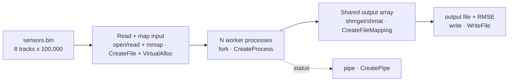
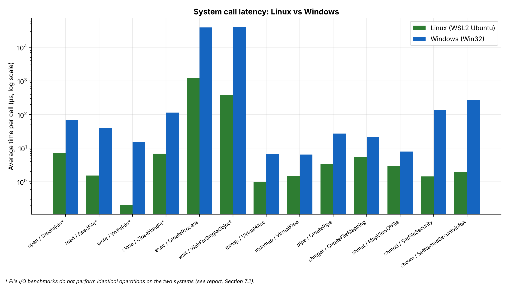
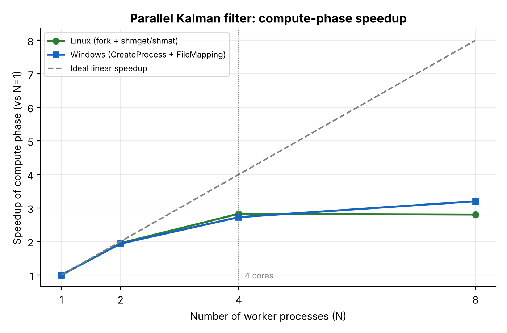
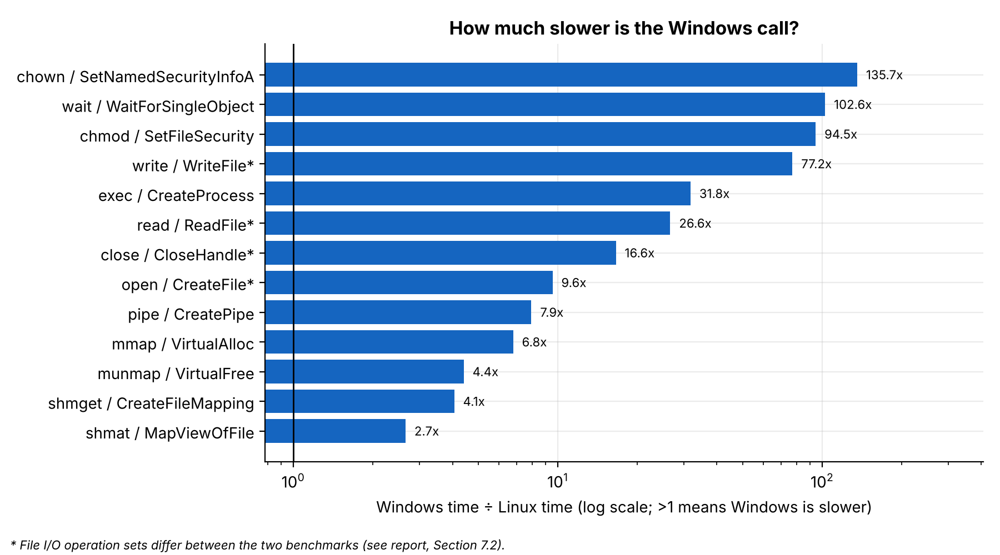
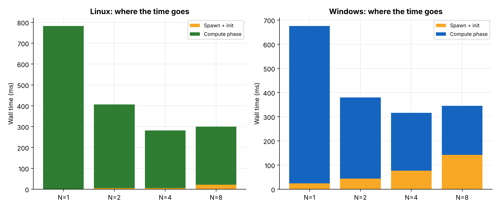
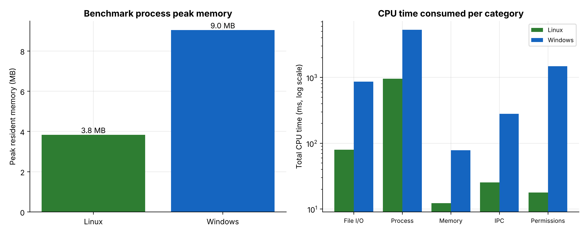

<div align="center">

# ⚙️ System Calls on Linux & Windows
### …with a multi-process Kalman filter

**CT-353 Operating Systems · Complex Computing Activity (CCA)**
Department of Computer Science & Information Technology · NED University of Engineering & Technology

[](#)
[](#)
[-2E9E5B?style=for-the-badge&logo=linux&logoColor=white)](#)
[](#)
[](#)

[](#)
[](#)
[](#)
[](#)
[](#)
[](#)

</div>

---

## 📑 Table of Contents
- [Overview](#-overview)
- [The 15 system calls](#-the-15-system-calls)
- [How it works](#-how-it-works)
- [Project structure](#-project-structure)
- [Quick start](#-quick-start)
- [Results](#-results)
- [Limitations](#-limitations)
- [Documentation](#-documentation)
- [Team](#-team)

## 🔍 Overview
This project explores how the **same operating-system services** are exposed on **Linux (POSIX)** and **Windows (Win32)**, measures what each one costs, and puts them to work in a real application: a **Kalman filter** that

1. reads noisy sensor data from a file,
2. keeps it in **memory-mapped** and **shared** arrays,
3. filters it **in parallel across several processes** (IPC with pipes and shared memory), and
4. writes the cleaned result back to disk.

Both operating systems write **CSV files with identical columns**, so the comparison is direct and reproducible.

### ✨ Highlights
- 🧩 **15 system calls** per OS with error checking and logging (`errno` / `GetLastError`)
- ⚡ **Multi-process Kalman filter** (N = 1, 2, 4, 8 workers) on both OSes
- 📊 Reproducible **latency, CPU and memory** benchmarks with charts
- 🧱 Modular C++17, **RAII wrappers**, one `CMakeLists.txt` for both platforms
- ✅ Same filtered **RMSE 0.7839 m** on Linux and Windows (raw noise ≈ 2.0 m)

## 🧩 The 15 system calls
| Category | 🐧 Linux | 🪟 Windows | Purpose |
|---|---|---|---|
| **File I/O** | `open` `read` `write` `close` | `CreateFile` `ReadFile` `WriteFile` `CloseHandle` | file access |
| **Process** | `fork` `exec` `wait` | `CreateProcess` `WaitForSingleObject` | create / wait for a process |
| **Memory** | `mmap` `munmap` | `VirtualAlloc` `VirtualFree` | memory mapping |
| **IPC** | `pipe` `shmget` `shmat` | `CreatePipe` `CreateFileMapping` `MapViewOfFile` | inter-process communication |
| **Permissions** | `chmod` `chown` `umask` | `SetFileSecurity` (+ `SetNamedSecurityInfo`) | access rights |

> Windows has no separate fork/exec (`CreateProcess` does both) and no `umask`.

## ⚙️ How it works


**Why parallelise across tracks?** One Kalman track is sequential (each step needs the previous one), but the 8 tracks are independent, so they are divided among N worker processes.

| Step | Linux | Windows |
|---|---|---|
| Read input | `open`, `read`, `mmap` | `CreateFile`, `ReadFile` → `VirtualAlloc` |
| Shared output | `shmget`, `shmat` | named `CreateFileMapping`, `MapViewOfFile` |
| Workers | `fork` × N | `CreateProcess` × N (`--worker`) |
| Start signal | not needed | semaphore *(ready)* + event *(go)* barrier |
| Status | `pipe` | `CreatePipe` |
| Finish | `waitpid` | `WaitForSingleObject` |

Each worker repeats its filtering pass `COMPUTE_PASSES = 50` times (identical output) so the compute phase is long enough to show speedup. Timing is reported as **spawn**, **compute** and **total**.

## 🗂 Project structure
```text
os-cca-kalman/
├── common/      kalman · logger · timer.hpp · bench.hpp · sensor_gen      (platform independent)
├── linux/       sys_file · sys_proc · sys_mem · sys_ipc · sys_perm · syscall_bench_linux · kalman_linux
├── windows/     sys_file_win · sys_proc_win · sys_mem_win · sys_ipc_win · sys_perm_win · syscall_bench_windows · kalman_windows
├── data/        sensors.bin · truth.bin (generated) · output_*.bin
├── results/     *.csv · fig1…fig5 (PNG) · os_cca.log
├── scripts/     plot_results.py
├── CMakeLists.txt · Makefile · README.md
```

## 🚀 Quick start

<details open>
<summary><b>🪟 Windows</b> (Developer PowerShell for Visual Studio 2022, from the project root)</summary>

```powershell
cmake -S . -B build
cmake --build build --config Release
build\Release\sensor_gen.exe                       # once: creates data\sensors.bin and truth.bin
build\Release\syscall_bench_win.exe                # demos + 15-call benchmark -> results\windows_results.csv
build\Release\syscall_bench_win.exe --demo-only    # demos only (does not touch the CSV)
build\Release\kalman_win.exe                       # scaling N=1,2,4,8 -> results\windows_kalman_scaling.csv
```
</details>

<details open>
<summary><b>🐧 Linux</b> (Ubuntu, g++ 11+; copy the project into the Linux file system first, not a mounted Windows drive)</summary>

```bash
cmake -S . -B build -DCMAKE_BUILD_TYPE=Release
cmake --build build -j
./build/sensor_gen                                 # once
./build/syscall_bench_linux                        # demos + benchmark -> results/linux_results.csv
./build/kalman_linux                               # scaling -> results/linux_kalman_scaling.csv
```
`make` is also available as a shortcut.
</details>

<details>
<summary><b>📈 Charts and tables</b> (any OS with Python 3)</summary>

```bash
pip install pandas matplotlib
python scripts/plot_results.py        # -> results/comparison.csv, comparison.md, fig1…fig5
```
</details>

## 📊 Results
> Final measured run · 4 cores · Linux = Ubuntu on WSL2 · Windows = native

### System-call latency (Windows ÷ Linux)
| Group | Linux | Windows | Windows slower by |
|---|---|---|---|
| Process creation (`exec` vs `CreateProcess`) | 1.22 ms | 38.8 ms | **≈ 32×** |
| `chmod` vs `SetFileSecurity` | 1.4 µs | 135.7 µs | **≈ 94×** |
| `chown` vs `SetNamedSecurityInfo` | 2.0 µs | 269.9 µs | **≈ 136×** |
| `mmap` vs `VirtualAlloc` | 0.98 µs | 6.7 µs | 6.8× |
| `pipe` vs `CreatePipe` | 3.4 µs | 27.1 µs | 7.9× |
| `shmat` vs `MapViewOfFile` | 3.0 µs | 8.0 µs | 2.7× |



### Kalman filter scaling (compute-phase speedup)
| Workers N | 1 | 2 | 4 | 8 |
|---|---|---|---|---|
| 🐧 Linux | 1.00× | 1.95× | **2.83×** | 2.80× |
| 🪟 Windows | 1.00× | 1.94× | **2.73×** | 3.20× |



<details>
<summary>More charts</summary>




</details>

### 🧠 Key findings
- Linux is faster in every like-for-like comparison. The gap is **smallest for memory/IPC** (≈ 3–8×), **large for process creation** and **largest for permission calls**.
- `fork` is copy-on-write and cheap; `CreateProcess` builds a new address space and loads the Win32 runtime. On Windows, threads or a worker pool suit short tasks better.
- Both systems scale to the 4 available cores; the peak is near N = 4.

## ⚠️ Limitations
- Linux ran under **WSL2 (a virtual machine)**; Windows ran natively on the same machine.
- The **file I/O micro-benchmarks are not identical** on the two systems (e.g. Linux `write` targets `/dev/null`), so those ratios are upper bounds. Process, memory, IPC and permission benchmarks are like-for-like.
- Windows CPU time has ≈ 15.6 ms resolution; CPU and memory are per process, not per call.
- Results vary 1–4× between runs; ordering and orders of magnitude stay the same. A transient ≈ 1 s `CreateProcessA` delay on freshly built executables was observed and not isolated.

## 📚 Documentation
- 📄 [Project report](docs/OS_CCA_Report.docx)
- 🎞 [Presentation](docs/OS_CCA_Presentation.pptx)

## 👥 Team
| Roll No. | Name |
|---|---|
| CT-24224 | Muhammad Taha Farrukh |
| CT-24221 | Muhammad Saad |
| CT-24244 | Uzair Ahmed |

**Instructor:** Miss Firdous Riaz

## 🙏 Acknowledgements
Silberschatz, Galvin & Gagne, *Operating System Concepts* (9th ed.); Linux man-pages; Microsoft Learn Win32 documentation; R. E. Kalman (1960). AI assistants (Claude, Antigravity) were used as development aids; all measurements were run and verified by the team.

<div align="center">

⭐ *CT-353 Operating Systems · NED University of Engineering & Technology · 2026* ⭐

</div>
